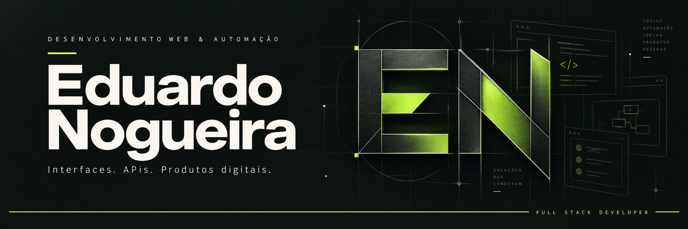

  

  
  &nbsp;
  

 

## Código com propósito. Aprendizado na prática.

Sou **Eduardo Nogueira**, desenvolvedor full stack. Construo interfaces com **React e TypeScript**, desenvolvo aplicações web e uso automação para simplificar tarefas do dia a dia.

Gosto de entender o problema antes de escolher a ferramenta. Meu foco é conectar uma experiência clara na interface a uma estrutura consistente de APIs e dados — aprendendo e melhorando a cada projeto.

 

### O que me move

<table>
  <tr>
    <td width="50%" valign="top">
      <h3>01 / Construir</h3>
      
Transformar uma necessidade em uma interface útil, uma integração ou uma ferramenta que economize trabalho.

      
<strong>Interfaces · Aplicações web · Automação</strong>

    </td>
    <td width="50%" valign="top">
      <h3>02 / Aprofundar</h3>
      
Evoluir em backend, modelagem de dados e integração entre sistemas, colocando os conceitos em prática.

      
<strong>APIs · Banco de dados · Produtos digitais</strong>

    </td>
  </tr>
</table>

 

### Tecnologias que fazem parte da minha jornada

**Interfaces**

**Backend e dados · aprofundando na prática**

**Ferramentas e automação**

 

### Explore alguns projetos públicos

<table>
  <tr>
    <td width="50%" valign="top">
      <h3><a href="https://github.com/EduardoN0gueira/Automacao_Python">Automação com Python ↗</a></h3>
      
Um script para levar informações de uma planilha a um site e reduzir o trabalho repetitivo.

      
PYTHON · AUTOMAÇÃO

    </td>
    <td width="50%" valign="top">
      <h3><a href="https://github.com/EduardoN0gueira/Clima">Clima ↗</a></h3>
      
Uma aplicação web para consultar o clima de uma cidade.

      
WEB · CONSULTA DE INFORMAÇÕES

    </td>
  </tr>
  <tr>
    <td width="50%" valign="top">
      <h3><a href="https://github.com/EduardoN0gueira/Projetos-Exemplares">Projetos Exemplares ↗</a></h3>
      
Projetos e trabalhos que fazem parte do meu percurso no desenvolvimento web.

      
DESENVOLVIMENTO WEB · PRÁTICA

    </td>
    <td width="50%" valign="top">
      <h3><a href="https://github.com/EduardoN0gueira/publicacoes">Caderno de código ↗</a></h3>
      
Espaço para compartilhar estudos, exemplos e pequenos experimentos. Conteúdo em construção.

      
ESTUDOS · EXEMPLOS · EXPERIMENTOS

    </td>
  </tr>
</table>

 

---

  <strong>Boas ideias ficam melhores quando a gente troca experiências.</strong> 
  <a href="https://www.linkedin.com/in/eduardo-nogueira-b07545288/">Vamos conversar sobre desenvolvimento e automação.</a>

