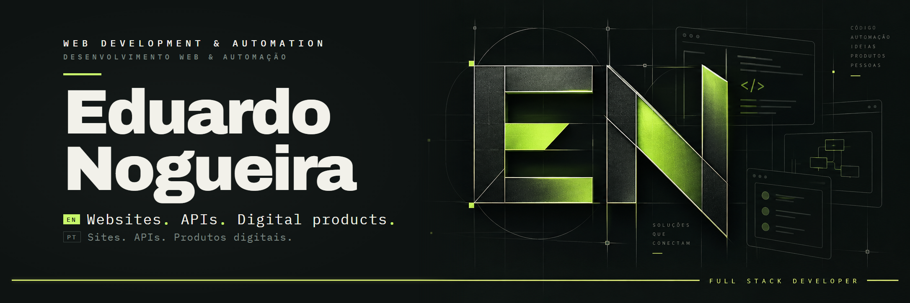
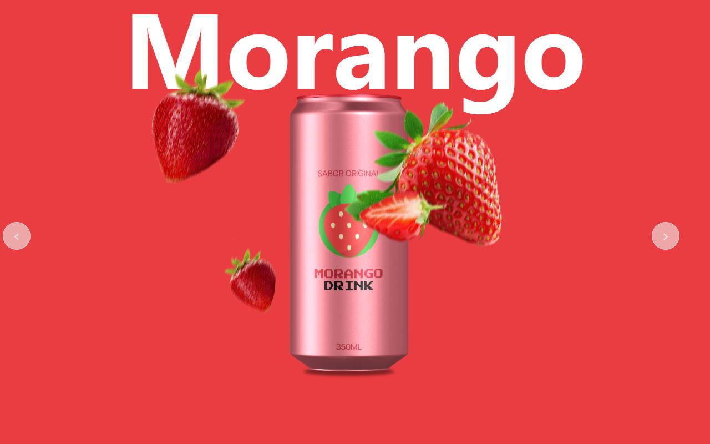
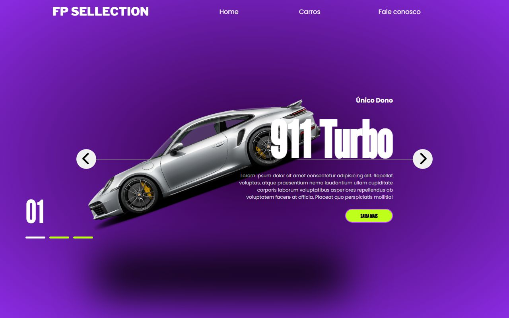
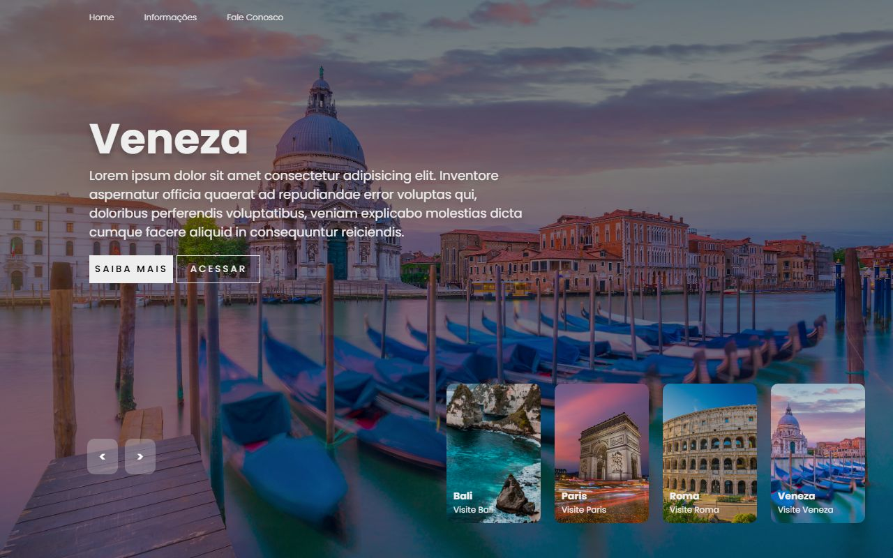
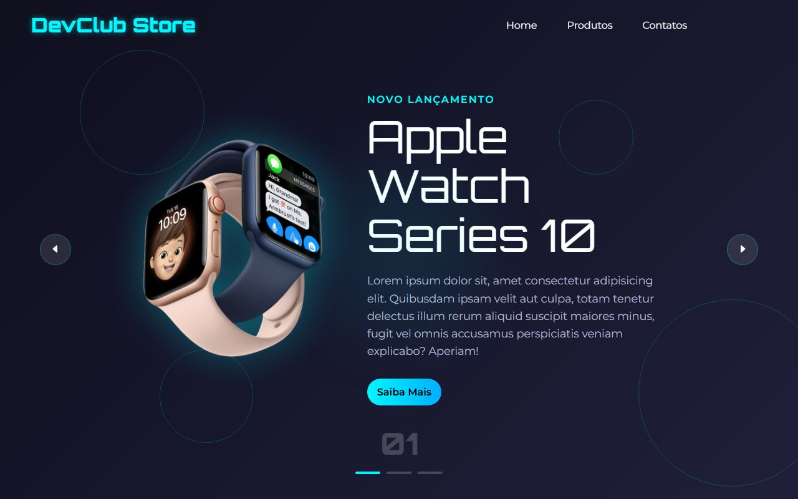

  

  
  &nbsp;
  

  EN · English below &nbsp;·&nbsp; PT · <a href="#em-português">Versão em português</a>

 

## Code with purpose. Learning by building.

I'm **Eduardo Nogueira**, a full stack developer from Brazil. I build **websites and web apps with React and TypeScript**, connect them to APIs and data, and use **automation** to take repetitive work off people's hands.

I like to understand the problem before choosing the tool. My focus is pairing a clear, fast interface with a solid structure behind it — and getting a little better with every project.

<table>
  <tr>
    <td width="50%" valign="top">
      <h3>01 / Build</h3>
      
Turn a real need into a website, an integration or a tool that saves time.

      
<strong>WEBSITES · WEB APPS · AUTOMATION</strong>

    </td>
    <td width="50%" valign="top">
      <h3>02 / Go deeper</h3>
      
Grow in backend, data modeling and system integration — by shipping, not just reading.

      
<strong>APIS · DATABASES · DIGITAL PRODUCTS</strong>

    </td>
  </tr>
</table>

 

### 🧰 Stack · Tecnologias

**Front-end**

**Back-end & data · Back-end e dados**

**Tools & automation · Ferramentas e automação**

 

### 🌐 Live demos · Demos ao vivo

Front-end studies you can open in the browser · Estudos de front-end para abrir no navegador

<table>
  <tr>
    <td width="50%" valign="top">
      
      <h4><a href="https://eduardon0gueira.github.io/Projetos-Exemplares/Projetos_Refrigerantes_Animados/">Animated product page ↗</a></h4>
      
Flavor carousel with animated cans and fruit. Carrossel de sabores com latas e frutas animadas.

      
HTML · CSS · JAVASCRIPT · ANIMATION

    </td>
    <td width="50%" valign="top">
      
      <h4><a href="https://eduardon0gueira.github.io/Projetos-Exemplares/Projeto_LP_Carros/">Car dealership landing ↗</a></h4>
      
Hero slider for a premium car showroom. Landing page com slider para uma loja de carros.

      
HTML · CSS · JAVASCRIPT · LANDING PAGE

    </td>
  </tr>
  <tr>
    <td width="50%" valign="top">
      
      <h4><a href="https://eduardon0gueira.github.io/Projetos-Exemplares/Projeto_Slider_lugares/">Travel destinations slider ↗</a></h4>
      
Full-screen gallery with destination cards. Galeria em tela cheia com cards de destinos.

      
HTML · CSS · JAVASCRIPT · UI

    </td>
    <td width="50%" valign="top">
      
      <h4><a href="https://eduardon0gueira.github.io/Projetos-Exemplares/Projeto_DevClub/">Tech store landing ↗</a></h4>
      
Product launch page with a smooth slider. Página de lançamento de produto com slider.

      
HTML · CSS · JAVASCRIPT · E-COMMERCE

    </td>
  </tr>
</table>

<a href="https://github.com/EduardoN0gueira/Projetos-Exemplares">More front-end projects · Mais projetos de front-end →</a>

### ⚙️ Automation · Automação

<table>
  <tr>
    <td valign="top">
      <h4><a href="https://github.com/EduardoN0gueira/Automacao_Python">Spreadsheet → website, with Python ↗</a></h4>
      
Reads rows from an Excel sheet and fills a web form automatically with Selenium — the kind of repetitive task that eats hours. Lê uma planilha do Excel e preenche um formulário web sozinho com Selenium.

      
PYTHON · SELENIUM · OPENPYXL

    </td>
  </tr>
</table>

 

---

<b>PT · Em português</b> (clique para abrir)

 

### Código com propósito. Aprendizado na prática.

Sou **Eduardo Nogueira**, desenvolvedor full stack no Brasil. Construo **sites e aplicações web com React e TypeScript**, conecto tudo a APIs e dados e uso **automação** para tirar o trabalho repetitivo das mãos das pessoas.

Gosto de entender o problema antes de escolher a ferramenta. Meu foco é unir uma interface clara e rápida a uma estrutura consistente por trás — e melhorar um pouco a cada projeto.

- **01 / Construir** — transformar uma necessidade real em um site, uma integração ou uma ferramenta que economize tempo.
- **02 / Aprofundar** — evoluir em backend, modelagem de dados e integração entre sistemas, colocando em prática.

As demos ao vivo e a automação acima têm descrição nos dois idiomas.

 

  <strong>Good ideas get better when we share them.</strong> 
  Boas ideias ficam melhores quando a gente troca experiências.  
  <a href="https://www.linkedin.com/in/eduardo-nogueira-b07545288/">Let's talk about websites and automation · Vamos conversar →</a>

