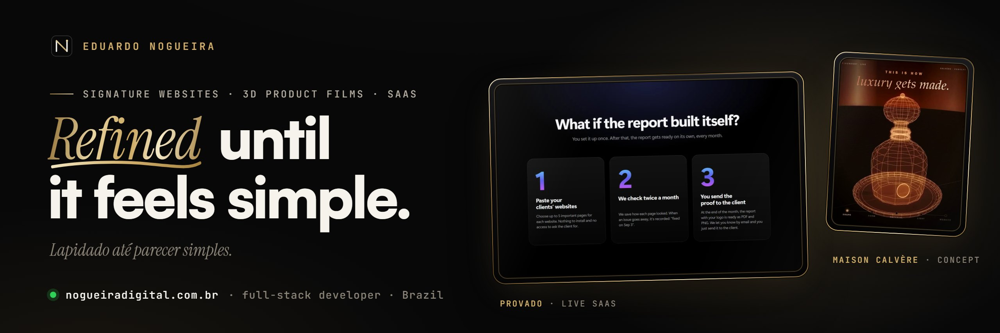
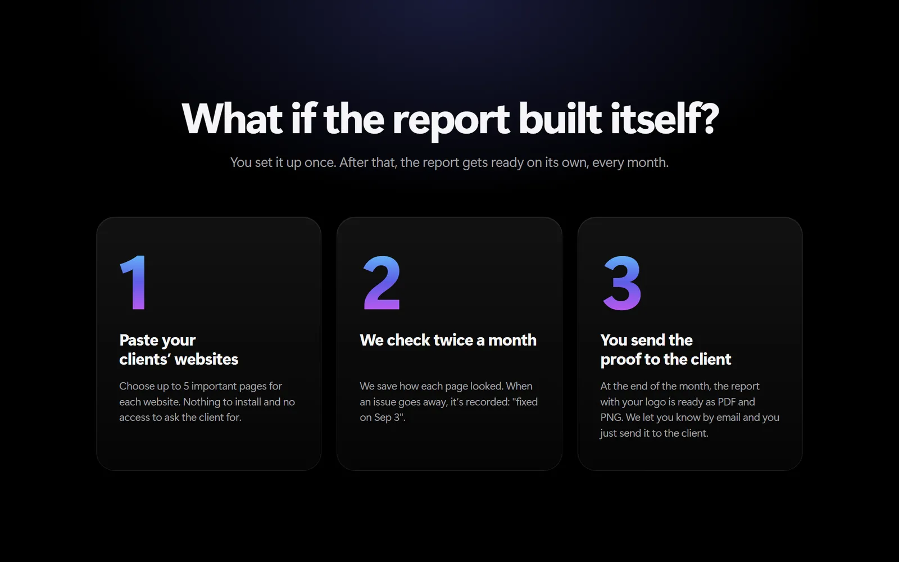
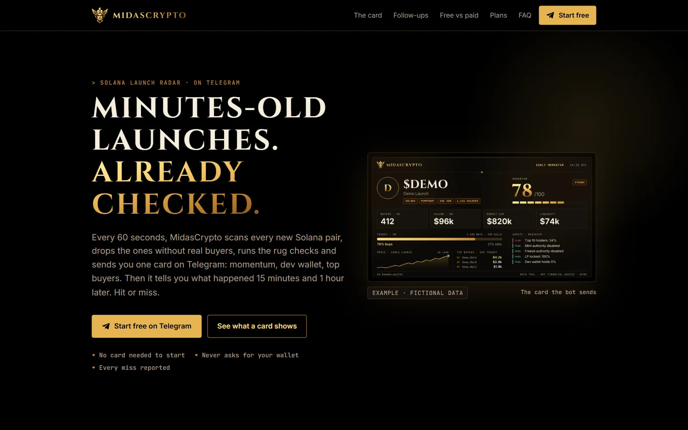
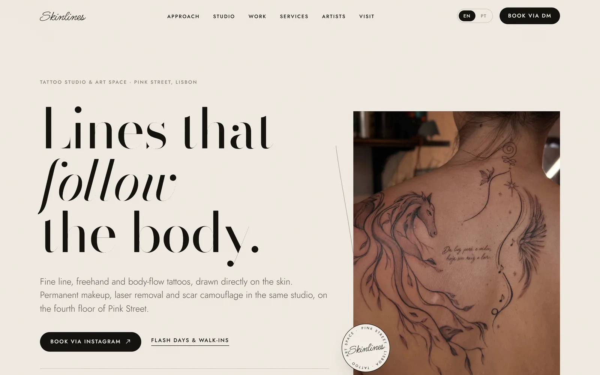
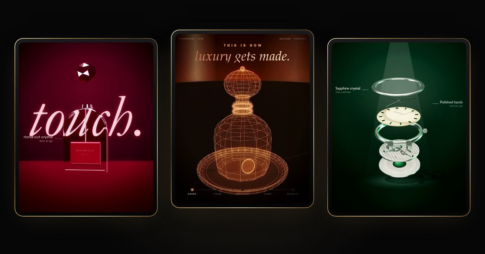
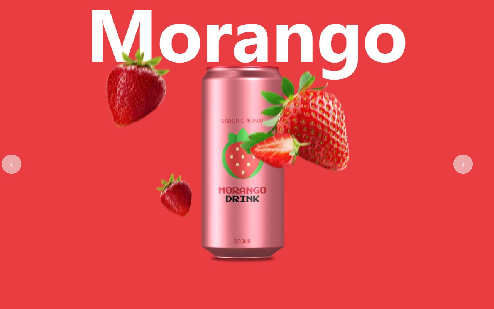
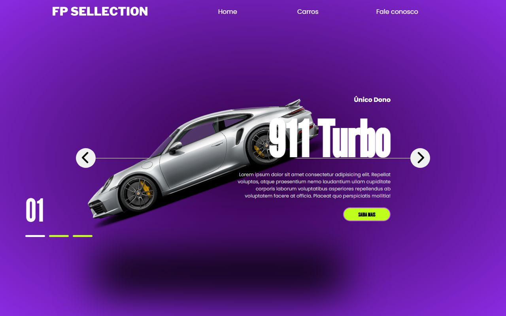
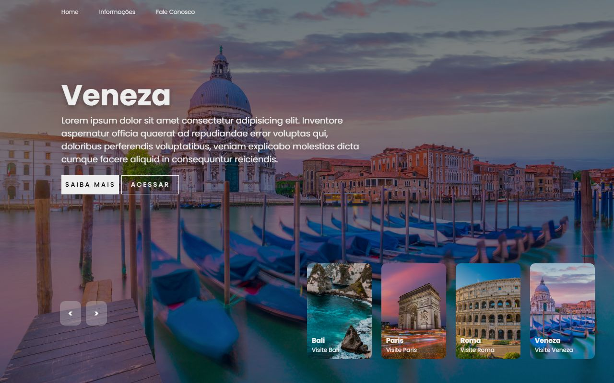
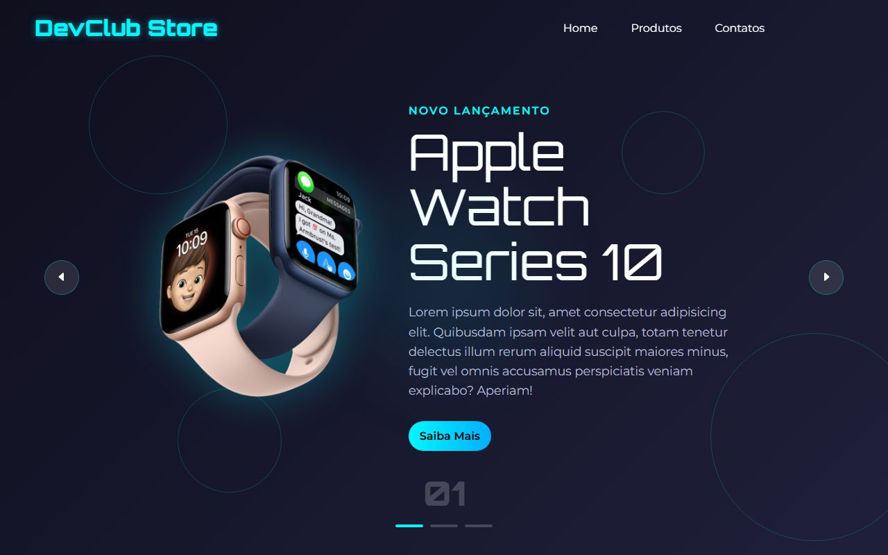

  

  
  &nbsp;
  
  &nbsp;
  

  EN · English below &nbsp;·&nbsp; PT · <a href="#em-português">Versão em português</a>

 

## Refined until it feels simple.

I'm **Eduardo Nogueira**, a full-stack developer from Brazil. I design and build **signature websites**, **3D product films** and **SaaS** — from the database to launch day.

By day I work on a product team (React, TypeScript, NestJS and Prisma), taking features from code review to production. The rest of the time I build my own products and systems for clients, thinking about the person behind the counter, not just the screenshot.

 

### ✦ Selected work · Trabalhos

<table>
  <tr>
    <td width="50%" valign="top">
      
      <h4><a href="https://provadoseo.com/">Provado ↗</a> &nbsp;🟢 LIVE</h4>
      
White-label proof of technical SEO work, for agencies. It checks client sites twice a month and builds the monthly report on its own — in English, Portuguese and Spanish, with Stripe checkout. Prova mensal do trabalho técnico de SEO, white-label, para agências.

      
NEXT.JS · SUPABASE · STRIPE · PLAYWRIGHT

    </td>
    <td width="50%" valign="top">
      
      <h4>MidasCrypto &nbsp;⏸ PAUSED</h4>
      
A Telegram data tool for new Solana launches, built with a friend: it filters every new pair, runs safety checks and sends one card, then reports what happened next. Ran in production in October; paused while I focus on Provado. Ferramenta de dados no Telegram para lançamentos na Solana. Pausada. Card de exemplo com dados fictícios.

      
PYTHON · TELEGRAM · DATA

    </td>
  </tr>
  <tr>
    <td width="50%" valign="top">
      
      <h4><a href="https://eduardon0gueira.github.io/skinlines-prototype/">Skinlines Art Space ↗</a> &nbsp;PROTOTYPE</h4>
      
An independent website prototype for a tattoo studio on Pink Street, Lisbon — editorial type, EN/PT, booking by DM. Not the studio's official site. Protótipo independente de site para um estúdio de tatuagem em Lisboa. Não é o site oficial.

      
HTML · CSS · JAVASCRIPT · <a href="https://github.com/EduardoN0gueira/skinlines-prototype">CODE</a>

    </td>
    <td width="50%" valign="top">
      
      <h4><a href="https://nogueiradigital.com.br/#films">3D product films ↗</a> &nbsp;CONCEPT · DESIGNED WITH AI</h4>
      
Short product films for concept brands — a perfume, a bottle, a watch — rendered in real time in the browser. Filmes 3D de produto para marcas-conceito, renderizados em tempo real no navegador.

      
THREE.JS · WEBGL · REACT

    </td>
  </tr>
</table>

 

### 🌐 Live demos · Demos ao vivo

Front-end studies you can open in the browser · Estudos de front-end para abrir no navegador

<table>
  <tr>
    <td width="50%" valign="top">
      
      <h4><a href="https://eduardon0gueira.github.io/Projetos-Exemplares/Projetos_Refrigerantes_Animados/">Animated product page ↗</a></h4>
      
Flavor carousel with animated cans and fruit. Carrossel de sabores com latas e frutas animadas.

      
HTML · CSS · JAVASCRIPT · ANIMATION

    </td>
    <td width="50%" valign="top">
      
      <h4><a href="https://eduardon0gueira.github.io/Projetos-Exemplares/Projeto_LP_Carros/">Car dealership landing ↗</a></h4>
      
Hero slider for a premium car showroom. Landing page com slider para uma loja de carros.

      
HTML · CSS · JAVASCRIPT · LANDING PAGE

    </td>
  </tr>
  <tr>
    <td width="50%" valign="top">
      
      <h4><a href="https://eduardon0gueira.github.io/Projetos-Exemplares/Projeto_Slider_lugares/">Travel destinations slider ↗</a></h4>
      
Full-screen gallery with destination cards. Galeria em tela cheia com cards de destinos.

      
HTML · CSS · JAVASCRIPT · UI

    </td>
    <td width="50%" valign="top">
      
      <h4><a href="https://eduardon0gueira.github.io/Projetos-Exemplares/Projeto_DevClub/">Tech store landing ↗</a></h4>
      
Product launch page with a smooth slider. Página de lançamento de produto com slider.

      
HTML · CSS · JAVASCRIPT · E-COMMERCE

    </td>
  </tr>
</table>

<a href="https://github.com/EduardoN0gueira/Projetos-Exemplares">More front-end projects · Mais projetos de front-end →</a>

### ⚙️ Automation · Automação

<table>
  <tr>
    <td valign="top">
      <h4><a href="https://github.com/EduardoN0gueira/Automacao_Python">Spreadsheet → website, with Python ↗</a></h4>
      
Reads rows from an Excel sheet and fills a web form automatically with Selenium — the kind of repetitive task that eats hours. Lê uma planilha do Excel e preenche um formulário web sozinho com Selenium.

      
PYTHON · SELENIUM · OPENPYXL

    </td>
  </tr>
</table>

 

### 🧰 Stack · Tecnologias

**Front-end & 3D**

**Back-end, data & payments · Back-end, dados e pagamentos**

**Tools & automation · Ferramentas e automação**

 

---

<b>PT · Em português</b> (clique para abrir)

 

### Lapidado até parecer simples.

Sou o **Eduardo Nogueira**, desenvolvedor full stack no Brasil. Desenho e construo **sites premium**, **filmes 3D de produto** e **SaaS** — do banco de dados ao dia do lançamento.

Durante o dia trabalho num time de produto (React, TypeScript, NestJS e Prisma), levando funcionalidades do code review até a produção. No resto do tempo crio meus próprios produtos e sistemas para clientes, pensando em quem está no balcão, não só no print bonito.

- **Provado** — no ar: prova mensal do trabalho técnico de SEO, white-label, para agências, em três idiomas e com checkout pela Stripe.
- **MidasCrypto** — pausado: ferramenta de dados no Telegram para lançamentos na Solana, feita com um amigo.
- **Skinlines Art Space** — protótipo independente de site para um estúdio de tatuagem em Lisboa (não é o site oficial).
- **Filmes 3D de produto** — conceitos criados com IA e renderizados em tempo real no navegador.

As demos ao vivo e a automação acima têm descrição nos dois idiomas. O portfólio completo está em **[nogueiradigital.com.br](https://nogueiradigital.com.br/)**.

 

  <strong>Have a project in mind?</strong> 
  Tem um projeto em mente?  
  <a href="https://nogueiradigital.com.br/">nogueiradigital.com.br →</a> &nbsp;·&nbsp; <a href="https://www.linkedin.com/in/eduardo-nogueira-b07545288/">LinkedIn →</a>

